# 💰 Fund Raiser Management System

A relational database project built with **Oracle SQL** for managing fundraising events, donors, donations, organizations, and fundraising teams.

📚 Course project for *Introduction to Database*, American International University-Bangladesh (AIUB), Spring 2023-2024 (Group 05).

---

## 📌 Overview
The system stores and manages:
- 🎉 **Events**: fundraising events with title, date, location, and type
- 🙋 **Donors**: people or entities who contribute funds
- 💵 **Donations**: amounts and dates of donations to events
- 🏢 **Organizations**: organizations that host or sponsor events
- 👥 **Fundraising Teams**: teams that run the events

---

## 🗺️ ER Diagram
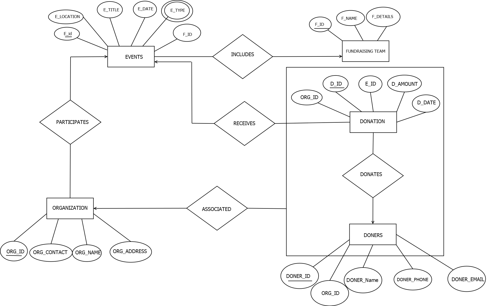

---

## ✅ What's Included
- 🧩 **ER Diagram**: entities, attributes, and relationships (including a ternary relationship between Organization, Donor, and Donation)
- 📐 **Normalization**: from UNF to 1NF, 2NF, and 3NF
- 🏗️ **Table Creation**: six related tables with primary and foreign keys
- 📝 **Data Insertion**: sample records for all tables
- 🔍 **SQL Queries**:
  - Single-row functions (`LOWER`, `NEXT_DAY`)
  - Aggregate functions with `GROUP BY` / `HAVING`
  - Subqueries
  - Joins
  - Views
- 🔣 **Relational Algebra** for key queries

---

## 🗄️ Database Tables
| Table | Purpose |
|---|---|
| `FUNDRAISING_TEAM` | Teams that organize events |
| `EVENTS` | Fundraising events |
| `DONATION` | Donation amounts and dates |
| `DONERS` | Donor details |
| `DONERSDONATION` | Links donors, donations, and organizations |
| `ORGANIZATION` | Hosting or sponsoring organizations |

---

## 📸 Screenshots
| | | |
|---|---|---|
| 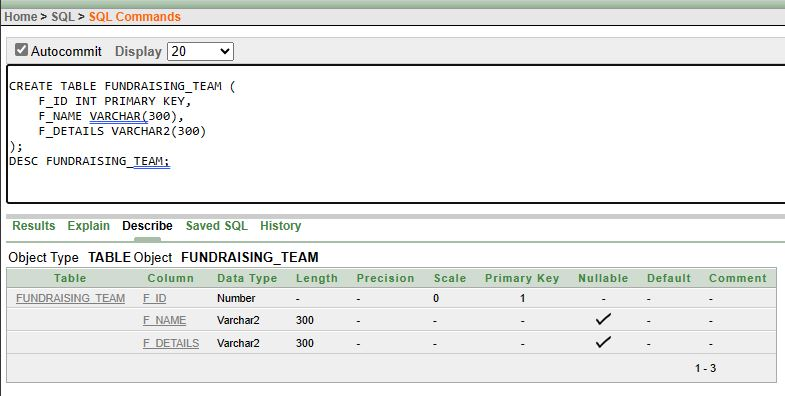 | 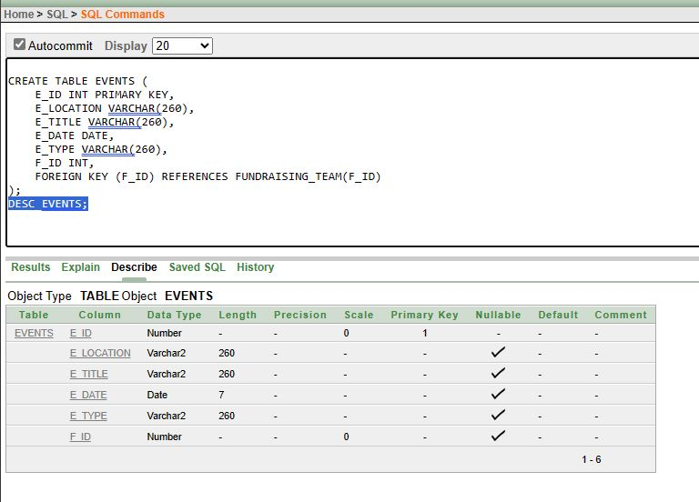 | 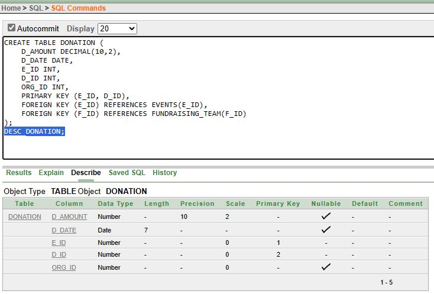 |
| 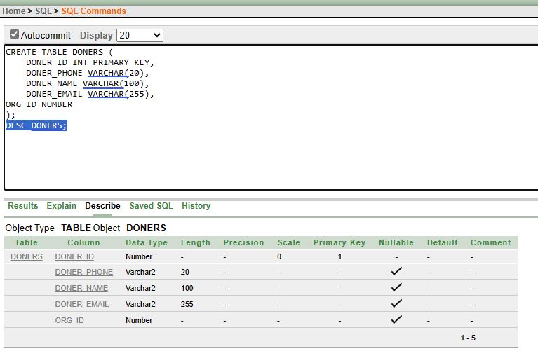 | 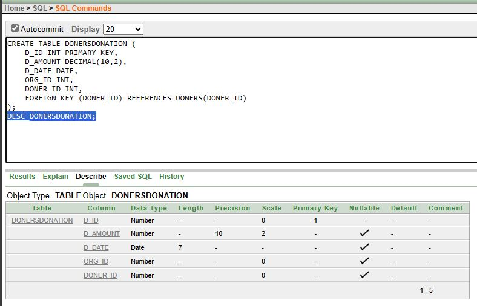 | 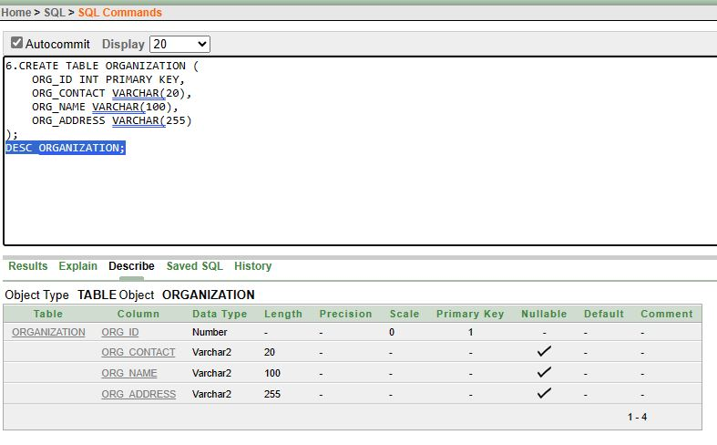 |
| 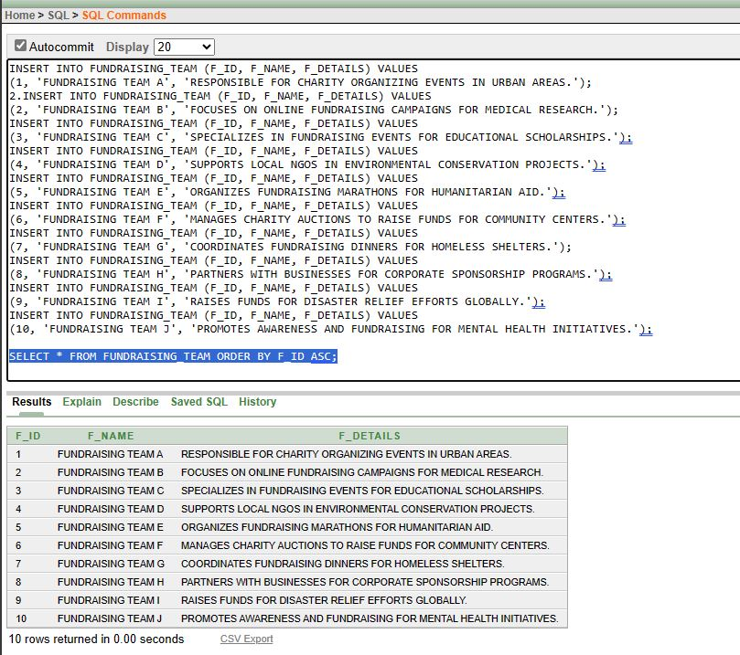 | 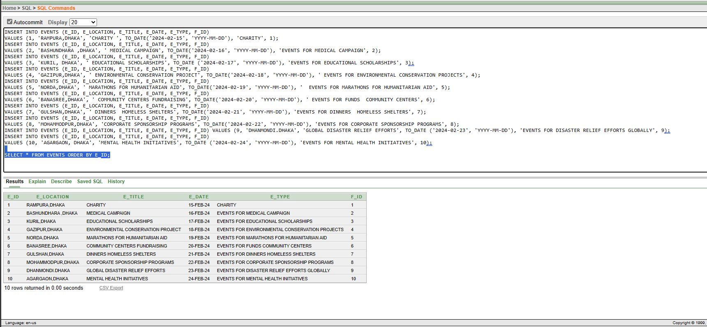 | 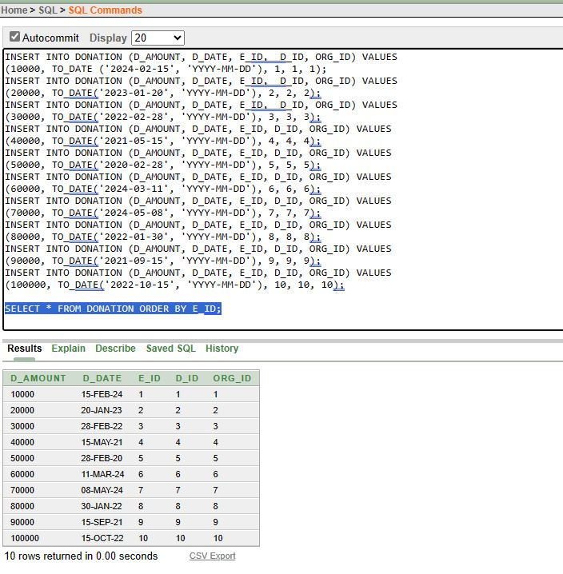 |
| 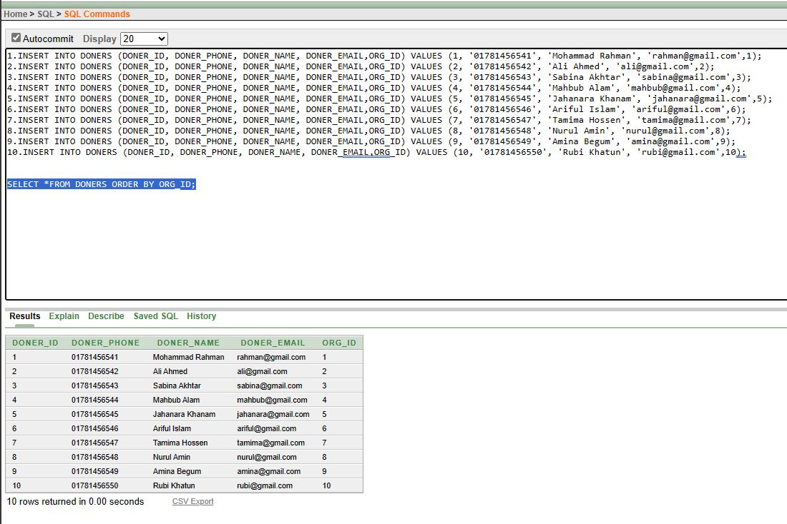 | 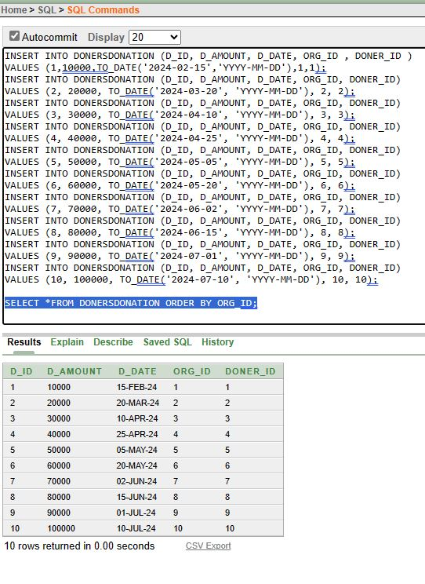 | 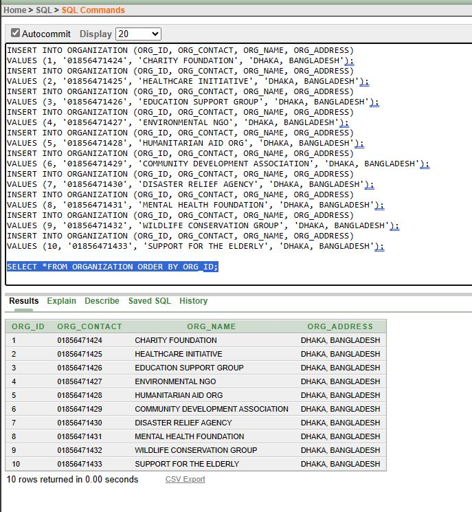 |

---

## 📂 Project Files
| File | Description |
|---|---|
| `DATABASE_INSERTIONDONE.txt` | SQL scripts for table creation and data insertion |
| `Diagram1.PNG` / `Diagram1.dia` | ER diagram (image and editable file) |
| `FINAL_DONE_PROJECT_GROUP_5_Fund_Raiser_Management_System.pdf` | Full project report |
| `1.JPG` – `12.JPG` | Query output screenshots |

---

## 🛠️ Tech Stack
- Oracle Database (SQL, SQL*Plus / SQL Developer)

## 👥 Team
Group 05, Section J, AIUB
- Ayon Kumar Bhowmick Ovi
- Sumiya Haider Risa
- Mst. Sharaf Anika Esha
- Md. Shaparan Ahammed
- Md. Raisul Hoque Chowdhury Alif